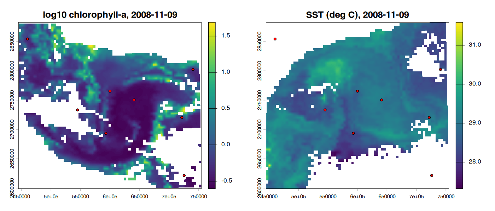

# Event-based MODIS data cubes in R

Build **satellite data cubes around point events** (for example, field-observed algal blooms) from
public **MODIS-Aqua** chlorophyll-a and sea-surface temperature, and turn them into a
presence / background table ready for species-distribution-style modelling (e.g. the
[`sdm`](https://CRAN.R-project.org/package=sdm) package).

This is a generic, cleaned-up version of the satellite-processing part of my doctoral work on
harmful algal blooms in the Persian Gulf. It uses only public data and contains no field observations.

## What it does

1. **Download** daily MODIS-Aqua Level-3 fields (4 km) for a bounding box and period from NOAA
   CoastWatch ERDDAP — no account needed (`R/download.R`).
2. **Convert** each day to a GeoTIFF on one shared 1 km UTM grid (log10 for chlorophyll-a).
3. **Build an event data cube** for every day in a window around each event and extract the
   predictor values at the event location (`R/datacube.R`). Only days on which all variables exist are
   used; cloudy pixels are flagged (`complete = FALSE`), never filled.
4. **Sample background points** from the same daily cubes and combine everything into a modelling table.

## The time window matters

The `window` argument is relative to the event date and decides what a model trained on the table can claim:

| `window` | Satellite days used | What a model can claim |
|---|---|---|
| `-10:-1` (default) | 1–10 days **before** the event | a forecast with 1–10 days lead time |
| `0` | the event day only | same-day detection (nowcasting) |
| `0:10` | the event day and the 10 days **after** | detection under an assumption that the event persists; **not** a forecast |

## Run the example

```r
install.packages("terra")
```
```bash
Rscript examples/run_example.R      # from the repository root, downloads ~2 MB
```

The example uses the Gulf of Oman, October–November 2008, and **25 synthetic events** (random water
locations and dates) purely to demonstrate the workflow.

### Example output

* `outputs/event_cube_values.csv` — one row per event and day offset, with `chla`, `sst` and `complete`
* `outputs/completeness_by_offset.csv` — share of cloud-free event pixels per day offset
* `outputs/modelling_table.csv` — presence (label 1) and background (label 0) rows
* `outputs/example_cube.png` — one daily cube with the events whose window includes that day

Daily ocean-colour data are heavily affected by cloud: in this example only **8–28 %** of event pixels
were cloud-free on any given day offset (25 events × 10 days → 43 complete presence rows, plus 2,186
background rows). Any operational use has to plan for these gaps.



## Adding more variables

Any daily gridded ERDDAP dataset can be added with `erddap_download()` + `nc_to_daily_tifs()` using the
same `template`, as long as the output files follow the `<var>_<YYYY-MM-DD>.tif` naming. For
remote-sensing reflectance (Rrs 412–555 nm), download NASA OceanColor Level-3 mapped files
(free Earthdata account) and write them with the same naming convention.

## Data and references

* MODIS-Aqua chlorophyll-a (`erdMH1chla1day`) and daytime SST (`erdMH1sstd1day`), NOAA CoastWatch ERDDAP,
  derived from NASA OceanColor Level-3 products.
* Naeimi, M., et al. (2025). Prediction of harmful algal blooms in the Persian Gulf using remote sensing and
  artificial intelligence modeling. *Journal of Sea Research*, 207, 102619.
  [doi:10.1016/j.seares.2025.102619](https://doi.org/10.1016/j.seares.2025.102619)

## Author

Mitra Naeimi · ORCID [0009-0003-3341-2263](https://orcid.org/0009-0003-3341-2263) · Licence: MIT
